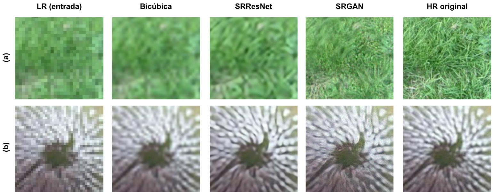
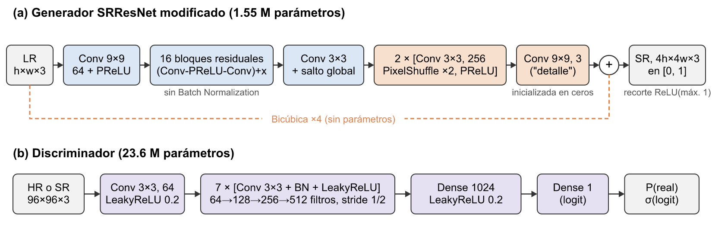

# Proyecto-final
# Super-resolución de imágenes ×4 con SRGAN

**Universidad Autónoma de Occidente — Redes Neuronales y Deep Learning**
Miniproyecto 3: Aplicación de arquitecturas de modelos generativos a la generación de imágenes.

Implementación desde cero, en TensorFlow/Keras, de una red generativa antagónica para super-resolución (SRGAN, Ledig *et al.*, 2017) con factor ×4, entrenada sobre un dataset propio de 2 800 imágenes.

## Integrantes

| Nombre | Código | Correo |
|---|---|---|
| José David Aguirre Salinas | 2230633 | jose.aguirre@uao.edu.co |
| Gabriel Armando Gil Grueso | 2230206 | gabriel.gil@uao.edu.co |

## Resultados

Conjunto de prueba de 280 imágenes (nunca vistas en el entrenamiento):

| Método | PSNR (dB) ↑ | SSIM ↑ | LPIPS ↓ |
|---|---|---|---|
| Bicúbica | 27.83 ± 4.49 | 0.769 ± 0.140 | 0.372 ± 0.158 |
| SRResNet (fase 1) | **29.60 ± 5.21** | **0.813 ± 0.128** | 0.262 ± 0.154 |
| SRGAN (fase 2) | 27.54 ± 4.69 | 0.733 ± 0.147 | **0.151 ± 0.082** |

- **SRResNet** es el mejor en fidelidad de píxeles: +1.76 dB sobre la bicúbica, mejor en el 100 % de las imágenes.
- **SRGAN** es el mejor en calidad perceptual: LPIPS 43 % menor que SRResNet, mejor en el 95.4 % de las imágenes.
- Ningún método gana en ambas dimensiones: es el **compromiso percepción-distorsión** (Blau & Michaeli, 2018).



*Arriba: caso en que SRGAN recupera la textura del pasto. Abajo: caso en que añade grano sobre filamentos regulares de una flor.*

Más detalle en [`resultados/`](resultados/) y en el [informe IEEE](informe/Informe_SRGAN_IEEE.pdf).

## Dataset

| Fuente | Contenido | Total | Entrenamiento | Validación | Prueba |
|---|---|---|---|---|---|
| DIV2K | Escenas 2K variadas | 800 | 640 | 80 | 80 |
| Oxford 102 Flowers | Flores, 102 especies | 1 000 | 800 | 100 | 100 |
| Oxford-IIIT Pet | Perros y gatos, 37 razas | 1 000 | 800 | 100 | 100 |
| **Total** | | **2 800** | **2 240** | **280** | **280** |

Los pares LR/HR se generan en línea reduciendo la HR ×4 con interpolación bicúbica. El dataset (`srgan_dataset_personalizado.zip`) no está en el repositorio por su tamaño.

## Modelo

- **Generador:** SRResNet de 16 bloques residuales con PixelShuffle (1.55 M de parámetros), con tres modificaciones:
  1. sin Batch Normalization (EDSR, ESRGAN);
  2. aprendizaje residual global: `SR = bicúbica(LR) + detalle`, con la última capa inicializada en ceros (VDSR);
  3. salida acotada a [0, 1] con `ReLU(max_value=1)`.
- **Discriminador:** 8 convoluciones + BN + LeakyReLU, Dense 1024, salida logit (23.6 M de parámetros).
- **Pérdidas:** fase 1 con MSE; fase 2 con `L_G = L_VGG54 + 1e-3·L_adv + L_MSE`.
- **Entrenamiento:** 18 épocas por fase (560 iteraciones por época, lote 16), Adam; la fase 2 baja la tasa de 1e-4 a 1e-5 a mitad de la fase. Total ≈ 75 min en una GPU T4, con semillas fijas y operaciones deterministas.



## Estructura del repositorio

```
Proyecto-final/
├── notebooks/
│   └── SRGAN_Super_Resolucion_x4.ipynb   # notebook completo (Colab) con todas las salidas
├── src/srgan/                            # el mismo código organizado en módulos
│   ├── config.py          # hiperparámetros
│   ├── modelos.py         # generador y discriminador
│   ├── perdidas.py        # VGG54, adversarial y MSE
│   ├── datos.py           # dataset, degradación y pipelines tf.data
│   ├── metricas.py        # PSNR, SSIM, VGG y LPIPS
│   ├── entrenamiento.py   # fase 1 y fase 2 con checkpoints
│   └── inferencia.py      # super-resolución por bloques
├── scripts/
│   ├── entrenar.py        # entrenamiento desde la terminal
│   └── super_resolver.py  # ampliar imágenes nuevas
├── resultados/            # historial por época, métricas de prueba y figuras
├── informe/               # informe en formato IEEE (PDF y Word)
└── requirements.txt
```

## Cómo usarlo

**Opción 1 — Google Colab (recomendada).** Abrir `notebooks/SRGAN_Super_Resolucion_x4.ipynb`, activar la GPU (*Entorno de ejecución → Cambiar tipo de entorno → T4*), poner el zip del dataset en `MyDrive/datasets/` y ejecutar todo. La sección 8 permite subir una imagen propia y ampliarla ×4.

**Opción 2 — Scripts.**

```bash
pip install -r requirements.txt
python scripts/entrenar.py --zip srgan_dataset_personalizado.zip --salida checkpoints
python scripts/super_resolver.py --pesos checkpoints/generador_srgan.weights.h5 mi_foto.jpg
```

## Referencias

- C. Ledig *et al.*, "Photo-realistic single image super-resolution using a generative adversarial network," CVPR, 2017.
- B. Lim *et al.*, "Enhanced deep residual networks for single image super-resolution," CVPRW, 2017.
- X. Wang *et al.*, "ESRGAN: Enhanced super-resolution generative adversarial networks," ECCVW, 2018.
- J. Kim, J. K. Lee y K. M. Lee, "Accurate image super-resolution using very deep convolutional networks," CVPR, 2016.
- Y. Blau y T. Michaeli, "The perception-distortion tradeoff," CVPR, 2018.
- R. Zhang *et al.*, "The unreasonable effectiveness of deep features as a perceptual metric," CVPR, 2018.
