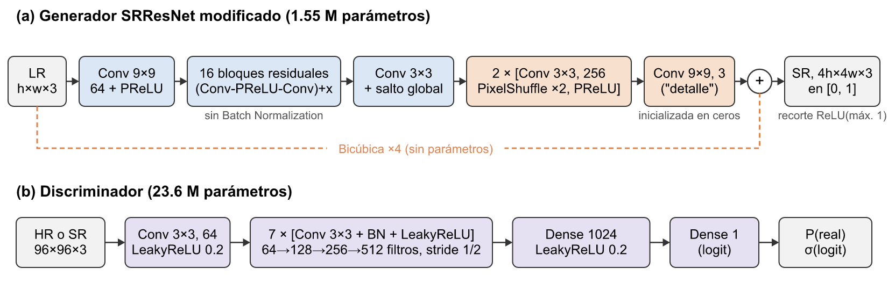
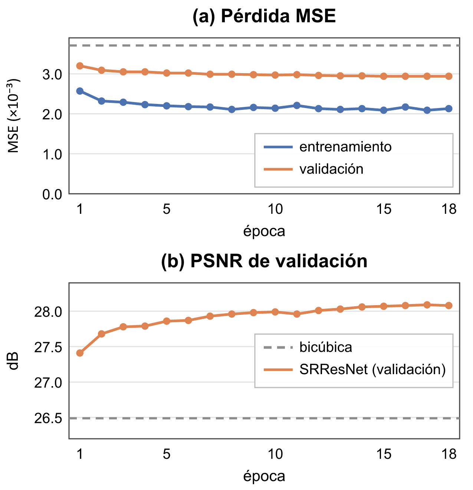
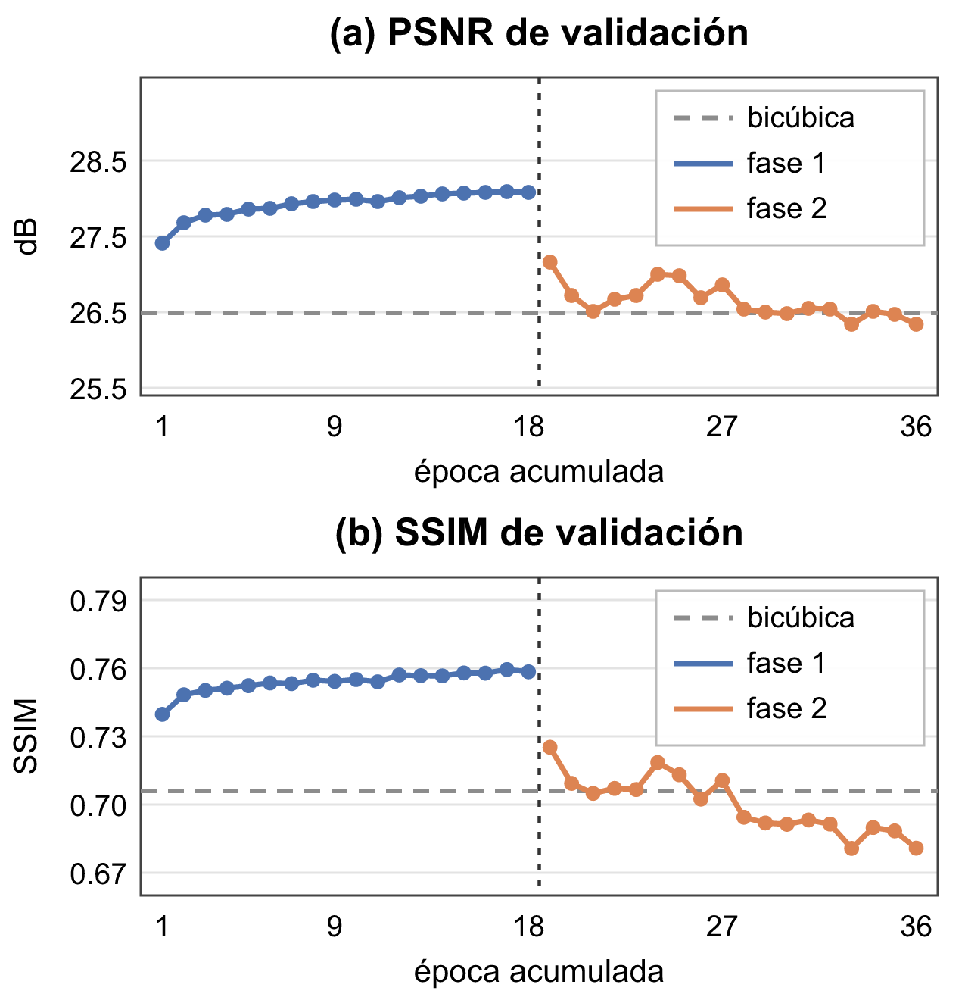
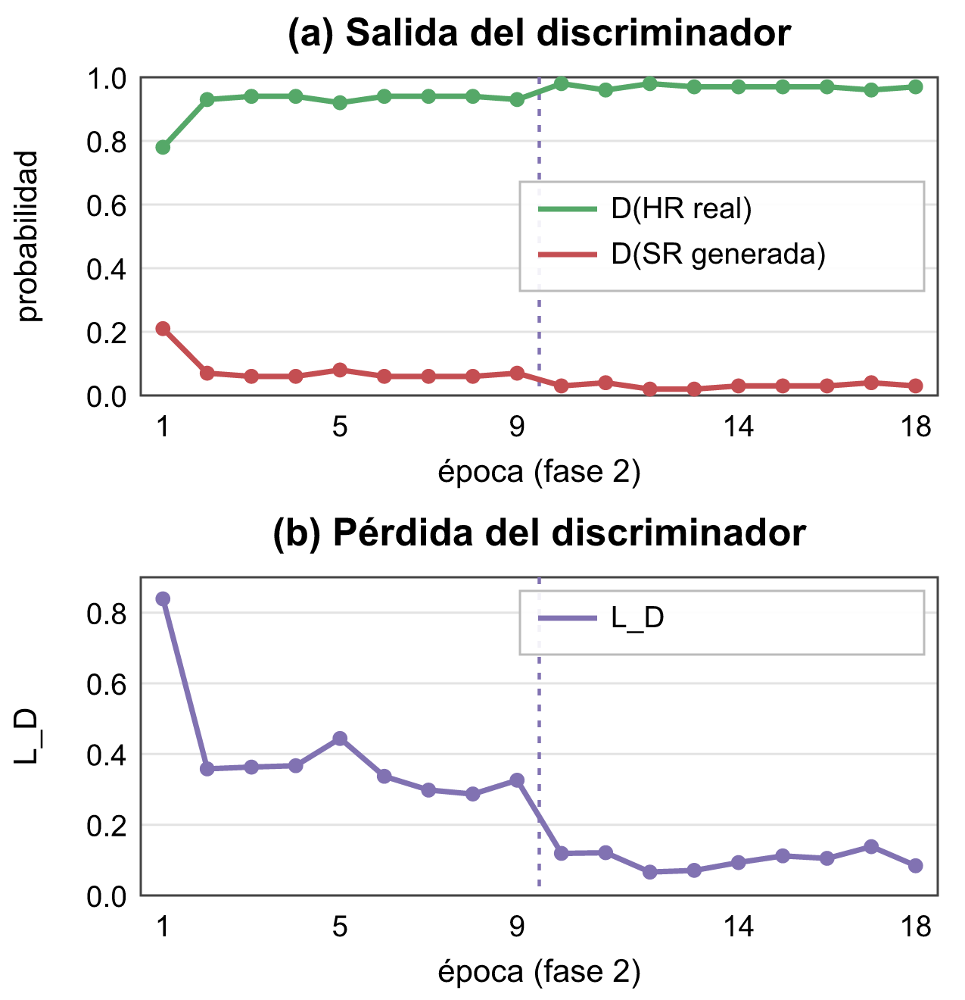
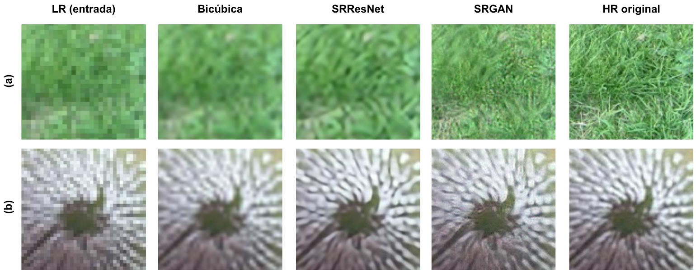

# Resultados

Resultados del entrenamiento desde cero en una GPU T4 (Google Colab).

| Archivo | Contenido |
|---|---|
| `historial_fase1.csv` | Métricas por época de la fase 1 (SRResNet, MSE): pérdida, PSNR y SSIM de validación, pérdida VGG, tiempo |
| `historial_fase2.csv` | Métricas por época de la fase 2 (SRGAN): L_G y sus componentes, L_D, D(real), D(falso), métricas de validación |
| `metricas_prueba.csv` | PSNR, SSIM y LPIPS (media y desviación estándar) en las 280 imágenes de prueba, global y por fuente |
| `figuras/` | Figuras del informe IEEE |

## Resumen en prueba (280 imágenes, ×4)

| Método | PSNR (dB) ↑ | SSIM ↑ | LPIPS ↓ |
|---|---|---|---|
| Bicúbica | 27.83 ± 4.49 | 0.769 ± 0.140 | 0.372 ± 0.158 |
| SRResNet | **29.60 ± 5.21** | **0.813 ± 0.128** | 0.262 ± 0.154 |
| SRGAN | 27.54 ± 4.69 | 0.733 ± 0.147 | **0.151 ± 0.082** |

## Figuras

| | |
|---|---|
|  | Generador SRResNet modificado y discriminador |
|  | Fase 1: pérdida MSE y PSNR de validación |
|  | PSNR y SSIM de validación en las 36 épocas |
|  | Equilibrio generador-discriminador en la fase 2 |
|  | Caso donde SRGAN mejora (pasto) y donde falla (filamentos de flor) |
